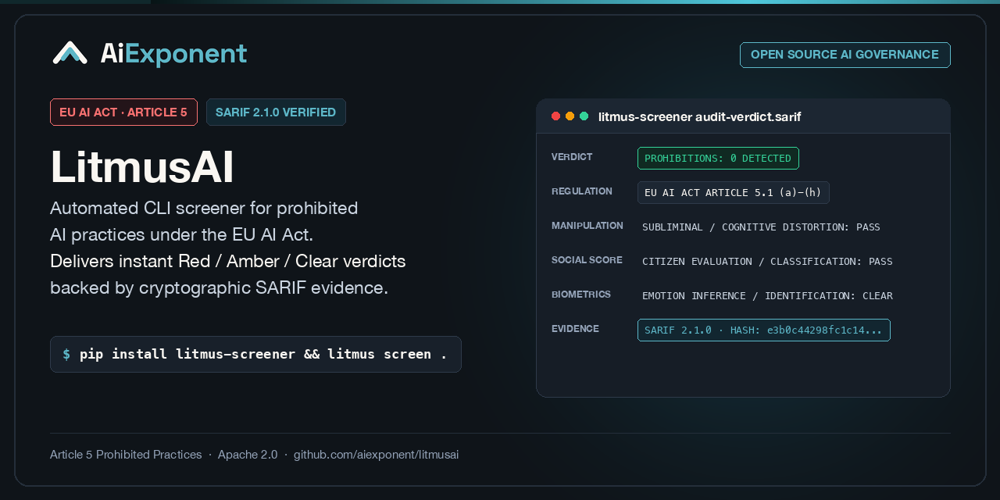
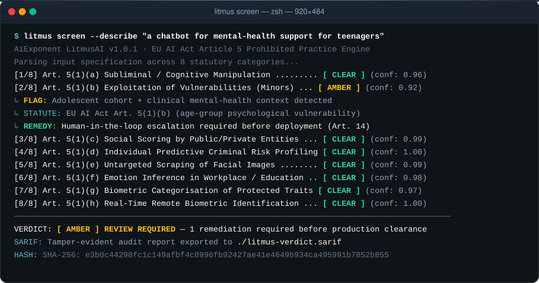
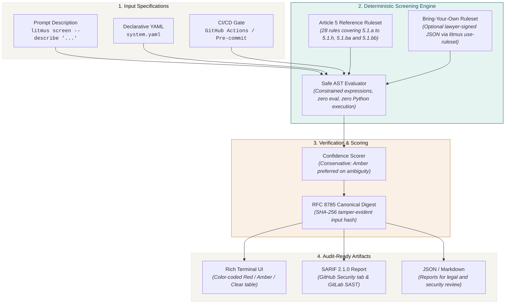

<div align="center">
  <picture>
    <source media="(prefers-color-scheme: dark)" srcset="https://raw.githubusercontent.com/aiexponent/litmusai/main/.github/brand/og-litmusai-dark.png">
    <source media="(prefers-color-scheme: light)" srcset="https://raw.githubusercontent.com/aiexponent/litmusai/main/.github/brand/og-litmusai-light.png">
    
  </picture>
  <h1 align="center">LitmusAI</h1>
  <p align="center"><em>Free, deterministic Article 5 screener for the EU AI Act.</em></p>
  <p align="center">
    <a href="https://pypi.org/project/litmus-screener/"></a>
    <a href="https://github.com/aiexponent/litmusai/actions"></a>
    <a href="LICENSE"></a>
    <a href="https://www.python.org/downloads/"></a>
    <a href="https://eur-lex.europa.eu/legal-content/EN/TXT/?uri=CELEX:32024R1689"></a>
    <a href="#privacy"></a>
    <a href="#legal-review-status"></a>
  </p>
</div>

---

> **LitmusAI 1.2.0 ships with the AiExponent reference ruleset `ruleset-2024-1689-v1.2` (UNREVIEWED: internal panel authored, no external lawyer review). Apache 2.0, AS IS.**
>
> The package's CLI surface, JSON/SARIF schema, and BYO-ruleset contract are stable for production integration. The reference ruleset has been authored and reviewed by an internal AiExponent panel (six engineering + governance roles) but has **not** been reviewed by a qualified EU AI Act practising lawyer. Every screening report carries this disclosure prominently. Customers who require lawyer-reviewed output can supply their own signed ruleset via the BYO mechanism; see [`docs/ruleset-authoring.md`](docs/ruleset-authoring.md).
>
> The legal-review status is not tied to a version number. `litmus --version` prints `ruleset_legal_status: REVIEWED` when the active ruleset carries a signature block, and `UNREVIEWED` when it does not. LitmusAI checks that the block is well formed; it does not verify the signature cryptographically or check who the signer is, so that line records what the ruleset author declared, not proof of a qualified legal review. Tracked under [Legal review status](#legal-review-status) below.

---

## The Problem

On **February 2, 2025**, Article 5 of the EU AI Act ([Regulation (EU) 2024/1689](https://eur-lex.europa.eu/legal-content/EN/TXT/?uri=CELEX:32024R1689)) entered into active legal enforcement across all 27 EU member states. 

Placing a prohibited AI practice on the market or putting it into service is **strictly illegal** and carries statutory administrative fines of up to **€35,000,000 or 7% of total worldwide annual turnover**.

Most engineering and product teams do not have an in-house EU AI Act counsel to review every model prompt, feature iteration, or system deployment. **LitmusAI** answers one critical question in your terminal or CI pipeline before you deploy:

> *"Is this AI practice prohibited under Article 5?"*

Screen your system against all **ten statutory categories** of Article 5(1): the original eight, points (a) to (h), and the two inserted by [Regulation (EU) 2026/1744](https://eur-lex.europa.eu/eli/reg/2026/1744/oj/eng), points (ba) and (bb), which apply from 2 December 2026. Receive a per-category **Red / Amber / Clear** verdict with exact legal citations, confidence levels, and concrete remediation advice, in under 60 seconds, completely offline, and without uploading sensitive system descriptions to any third-party server.

Built by [AI Exponent LLC](https://aiexponent.com). Apache 2.0. Runs entirely offline after `pip install`.

---

## Quick Start

```bash
pip install litmus-screener   # the brand is "LitmusAI"; the PyPI distribution is "litmus-screener"
```

```bash
# 1. Quick screen from a plain-text prompt
litmus screen --describe "a chatbot for mental health support for teenagers"

# 2. Or initialize a structured declaration for your system
litmus init                                         # creates system.yaml starter template
litmus screen system.yaml --output report.json      # full ten-category evaluation

# 3. Export audit-ready reports for legal or security teams
litmus export report.json -o report.sarif --format sarif
```

<p align="center">
  
</p>

---

## Why LitmusAI

| Evaluation Method | Cost | Turnaround | Deterministic / Repeatable? | Offline / Zero-Telemetry? |
| :--- | :--- | :--- | :--- | :--- |
| **Big 4 Consulting** | €50K–€150K | 4–8 Weeks | ❌ No (Advisory opinion) | ❌ No (NDAs & data sharing) |
| **Enterprise GRC Platforms** | $40K–$120K/yr | Weeks | ⚠️ Partial | ❌ No (Transfers system specs to cloud) |
| **Internal Spreadsheets** | "Free" | Days | ❌ No (Human error) | ⚠️ Manual |
| **LitmusAI** | **Free (Apache 2.0)** | **< 60 seconds** | **✅ Yes (Deterministic hash)** | **✅ Yes (100% offline, zero network)** |

---

## System Architecture

LitmusAI operates as a deterministic, offline static-analysis pipeline:



---

## What LitmusAI Does

- **All ten Article 5 points**: The reference ruleset has rules for every prohibited practice under Article 5(1), points (a) to (h) plus (ba) and (bb) from Regulation (EU) 2026/1744. A report run before 2 December 2026 says that the two new points apply from that date. How well each point is detected is measured, and limited; see [Known limits](#known-limits).
- **Deterministic by Design**: Same input + same ruleset = identical output, guaranteed across platforms.
- **Zero Network Calls (NFR-8)**: 100% offline execution. No telemetry, no telemetry pings, no crash reports. Your architecture and prompts never leave your local machine (enforced in CI via `pytest-socket`).
- **Cryptographic Tamper-Evidence**: Generates a canonical RFC 8785 SHA-256 digest on every report. Verify report integrity anytime via `litmus verify <report>`.
- **Bring-Your-Own-Ruleset (BYO)**: Legal counsel can author, sign, and distribute custom rulesets. Once activated (`litmus use-ruleset`), reports show `(SIGNED by: Counsel)` rather than `UNREVIEWED` in the provenance line.
- **Multi-Format Export**: Native support for rich console output, machine-readable JSON, Markdown documentation, and SARIF 2.1.0.

---

## Article 5 Categories Covered

| Category | Prohibition | Statutory Citation | Verdict Logic |
| :--- | :--- | :--- | :--- |
| **5.1.a** | Harmful manipulation & cognitive distortion | Art. 5(1)(a) | Read from the `influence` questions. **RED** when a subliminal, or purposefully manipulative or deceptive, technique is declared together with material distortion of behaviour and likely significant harm; **AMBER** when any of those is `not_sure` and none is `no`. Left `not_answered`, the 1.1 proxies apply (RED for emotional-state inference with behaviour prediction, AMBER for behaviour prediction) and confidence is low. |
| **5.1.b** | Exploitation of vulnerable groups (age/disability) | Art. 5(1)(b) | Read from the `influence` questions. **RED** when exploitation of a vulnerability due to age, disability or a specific social or economic situation is declared together with material distortion and likely significant harm; **AMBER** when any of those is `not_sure` and none is `no`. Left `not_answered`, the 1.1 proxies apply (RED for `minors` with behaviour prediction, AMBER for `minors` with free-text generation or `persons_in_vulnerable_economic_situations`) and confidence is low. |
| **5.1.ba** | Non-consensual intimate material of identifiable persons (applies from 2 December 2026) | Art. 5(1)(ba), 5(1a), 5(1b), as inserted by Regulation (EU) 2026/1744 | **RED** if generating such material is the intended purpose without demonstrable consent, or is a foreseeable and reproducible outcome with no demonstrable consent and no adequate, documented safeguards; **AMBER** if realistic media of identifiable people is generated and safeguards or consent are undocumented. Edits that do not increase exposure (Art. 5(1b)) never reach RED. |
| **5.1.bb** | Child sexual abuse material (applies from 2 December 2026) | Art. 5(1)(bb), 5(1a), as inserted by Regulation (EU) 2026/1744; Directive 2011/93/EU Art. 2(c) and (e) | **RED** if such material is a foreseeable and reproducible outcome, nothing reliably prevents it, and the system is not declared for law-enforcement use; **AMBER** for any realistic-media generator without documented prevention, and for law-enforcement use where a "without right" defence may apply. No consent carve-out. |
| **5.1.c** | Social scoring by public or private actors | Art. 5(1)(c) | **RED** if scoring from social behaviour data, from scraped internet data, or if the score leads to detrimental treatment in an unrelated context; **AMBER** for any other individual scoring, including credit scoring from repayment history (high-risk under Annex III, not prohibited). |
| **5.1.d** | Predictive criminal risk profiling | Art. 5(1)(d) | **RED** when the system outputs criminal risk predictions (`outputs.criminal_risk_predictions`); **AMBER** instead when `scope.human_assessment_on_verifiable_facts` is `yes`, because that exclusion needs evidence. |
| **5.1.e** | Untargeted facial image scraping | Art. 5(1)(e) | **RED** if the system takes facial images and scraped internet data; **AMBER** for facial images in a public space. **Clear** when `scope.untargeted_collection` or `scope.builds_facial_recognition_database` is `no`. |
| **5.1.f** | Emotion inference in workplace or education | Art. 5(1)(f) | **RED** if the system infers emotions in a workplace or education setting; **AMBER** for emotion inference elsewhere, including healthcare, and when `scope.medical_or_safety_reasons` is `yes`. **Clear** when `scope.emotions_of_workers_or_students` is `no` (only customers, patients or the public). |
| **5.1.g** | Biometric categorisation of sensitive traits | Art. 5(1)(g) | **RED** if biometric data or facial images are used to classify sensitive attributes (`outputs.sensitive_attribute_classifications`); **AMBER** for sensitive-attribute classification from other data, and when `scope.dataset_labelling_or_filtering_only` is `yes`. |
| **5.1.h** | Real-time remote biometric identification | Art. 5(1)(h) | **RED** for real-time biometric or facial identification in a public space; **AMBER** when `scope.article_5_1_h_objective` is `yes` (one of the objectives in Art. 5(1)(h)(i) to (iii); Art. 5(2) and (3) add authorisation and an impact assessment). **Clear** when `scope.role` is `provider_only` (point (h) prohibits use), or `scope.remote_identification` or `scope.law_enforcement_purpose` is `no`. |

---

## Known limits

LitmusAI screens what a `system.yaml` declares, and a rule can only use a field that exists. An independent test, run on 2 November 2026 by a tester who never saw the rules, screened 175 worked examples from the European Commission's Guidelines on prohibited AI practices (C(2025) 5052) and the recitals of Regulation (EU) 2026/1744 with litmus-screener 1.1.2, and repeated it with 1.1.3, which gave the same verdict on every case. The cases, the expected answers written before the run, the scripts, the full scorecard and a [report](verification/REPORT.md) giving the cause of every miss and false alarm are in [`verification/`](verification/), and anyone can re-run them with `verification/run.sh`.

| Result on 1.1.2 and 1.1.3 (full screen) | Count |
| :--- | :--- |
| Expected prohibitions found (red) | 44 of 51 |
| Expected prohibitions flagged for review (amber) | 1 of 51 |
| Expected prohibitions missed (clear) | 6 of 51, all on points (a) and (b) |
| Permitted cases screened red (false alarms) | 32 of 113 |

What that meant, and what 1.2.0 changes:

- **Points (a) and (b) were not detected from their legal elements in 1.1.x.** 1.2.0 adds the `influence` questions. A file that leaves them at `not_answered` keeps its 1.1 verdict, with low confidence on (a) and (b), so answer them.
- **Exceptions and exclusions** for points (d), (e), (f), (g) and (h) were not modelled in 1.1.x and caused most false alarms. 1.2.0 adds the `scope` questions for the ones written in Article 5(1). Facts that take a system outside a prohibition clear it; exceptions that need evidence (human assessment, medical or safety reasons, dataset labelling, the (h)(i) to (iii) objectives) give AMBER for a reviewer.
- **Still not modelled in 1.2.0:** accidental generation, emergency medical use and the red-teaming defence for (ba) and (bb), which the recitals of Regulation (EU) 2026/1744 describe; relevance and proportionality under sectoral law for (c); emotion recognition used only for a person's own training. A RED on those needs a reviewer.
- **Every answer is self-declared.** LitmusAI cannot check that a declared exception holds.
- `deployment_context.workplace` and `education` describe where the system is used. Whose emotions are inferred is the `scope.emotions_of_workers_or_students` question.
- The quick screen (`--describe`) infers fields from keywords, does not answer the new questions, and misses more: 27 of 51 expected prohibitions came back clear on 1.1.x.

The independent test will be re-run on 1.2.0 with declarations that answer the new questions, and the result published next to this one. The author of the 1.2.0 rules saw the 1.1.x results, so that re-test is weaker evidence than the first run.

---

## Interactive Artifact Previews

<details>
  <summary><b>📄 View Starter <code>system.yaml</code> Template</b></summary>

This is what `litmus init` writes (litmus-screener 1.2.0). `subject_population.categories` accepts `general_public`, `minors`, `workers`, `students`, `persons_with_disabilities`, `persons_in_vulnerable_economic_situations`, `older_persons` and `other`. Each `influence` and `scope` answer is `yes`, `no`, `not_sure` or `not_answered`; an unquoted YAML `yes` or `no` is accepted.

```yaml
# LitmusAI System Description
# Edit the fields below to describe your AI system.
# Then run: litmus screen system.yaml

name: "My AI System"
version: "1.0.0"
provider: "My Organisation"
deployer: "My Organisation"
purpose: "Describe what the system does in one sentence."
system_description: |
  A more detailed description of the system: what inputs it takes,
  what outputs it produces, and how those outputs are used.

deployment_jurisdictions:
  - EU

output_consumed_in_eu: true

subject_population:
  categories:
    - general_public
  notes: null

inputs:
  biometric: false
  facial_images: false
  emotional_state_inference: false
  behaviour_history: false
  social_behaviour_data: false        # conduct outside the service: social media, associations
  scraped_internet_data: false
  freetext_prompts: false
  other: null

outputs:
  individual_scores: false
  behaviour_predictions: false
  criminal_risk_predictions: false
  emotion_inferences: false
  sensitive_attribute_classifications: false
  freetext_generations: false
  detrimental_treatment_unrelated_context: false   # score used against the person elsewhere
  other: null

deployment_context:
  workplace: false
  education: false
  public_space: false
  real_time_operation: false
  law_enforcement_use: false
  healthcare: false
  financial_services: false
  other: null

# Article 5(1)(ba) and (bb), inserted by Regulation (EU) 2026/1744 and
# applicable from 2 December 2026. Leave everything false for a system
# that does not generate or manipulate realistic images, video or audio.
generative_media:
  realistic_media_generation: false   # realistic images, video, audio or similar material
  identifiable_persons: false         # outputs can depict identifiable real people
  intimate_depictions_possible: false # intimate parts or sexual activity, without major modification
  intimate_depictions_intended: false # that output is the system's purpose
  minors_depictions_possible: false   # outputs can depict children in such material
  manipulation_within_1b_only: false  # edits that neither increase exposure nor change the activity
  safeguards:                         # each one: in place, in force and verifiable
    consent_demonstrable: false       # explicit consent of each depicted person, collected and provable
    intimate_output_prevention: false # filters, refusal training, guardrails against intimate outputs
    csam_prevention: false            # measures against child sexual abuse material
    misuse_correction: false          # abuse detection, notice and action, follow-up on circumvention
    documented: false                 # the measures above are written down and testable

# Article 5(1)(a) and (b). Answer each question "yes", "no" or "not_sure".
# A question left at "not_answered" keeps the screen on capability proxies,
# with low confidence. All yes for (a) or (b) is RED; any not_sure is AMBER.
influence:
  subliminal_techniques: not_answered                # (a) stimuli a person cannot perceive
  manipulative_or_deceptive_techniques: not_answered # (a) purposefully manipulative or deceptive
  exploits_vulnerability: not_answered               # (b) due to age, disability or social or economic situation
  materially_distorts_behaviour: not_answered        # (a, b) people decide what they would not otherwise
  significant_harm_likely: not_answered              # (a, b) physical, psychological or financial harm

# Exceptions and limits in Article 5(1), points (d) to (h). Answer only those
# that apply; leave the rest at "not_answered". A "no" marked "clears" takes
# the system outside that point; a "yes" marked "amber" claims an exception
# a reviewer must check.
scope:
  role: both                                         # provider_only, deployer or both; (h) prohibits use only
  human_assessment_on_verifiable_facts: not_answered # (d) yes: amber
  untargeted_collection: not_answered                # (e) no (a targeted search): clears
  builds_facial_recognition_database: not_answered   # (e) no: clears
  emotions_of_workers_or_students: not_answered      # (f) no (customers, patients, public): clears
  medical_or_safety_reasons: not_answered            # (f) yes: amber
  dataset_labelling_or_filtering_only: not_answered  # (g) yes: amber
  remote_identification: not_answered                # (h) no (person steps up to a sensor): clears
  law_enforcement_purpose: not_answered              # (h) no: clears
  article_5_1_h_objective: not_answered              # (h) yes, one of (i) to (iii): amber

mitigations: []

metadata:
  last_reviewed: null
  owner: null
  reviewed_by: null
```
</details>

<details>
  <summary><b>🔍 View Audit-Ready SARIF 2.1.0 Output</b></summary>

```json
{
  "$schema": "https://raw.githubusercontent.com/oasis-tcs/sarif-spec/main/sarif-2.1/schema/sarif-schema-2.1.0.json",
  "version": "2.1.0",
  "runs": [
    {
      "tool": {
        "driver": {
          "name": "LitmusAI",
          "version": "1.2.0",
          "informationUri": "https://aiexponent.com/products/litmusai",
          "rules": [
            {
              "id": "litmusai/5.1.b",
              "name": "Vulnerability Exploitation",
              "shortDescription": {
                "text": "Article 5(1)(b) Exploitation of age, disability, or specific social vulnerability"
              },
              "helpUri": "https://aiexponent.com/eu-ai-act/article-5"
            }
          ]
        }
      },
      "results": [
        {
          "ruleId": "litmusai/5.1.b",
          "level": "warning",
          "message": {
            "text": "Conversational agent targets minors experiencing psychological distress without clinician escalation safeguards."
          }
        }
      ]
    }
  ]
}
```
</details>

---

## CI/CD Integration & Exit Codes

Add LitmusAI to your GitHub Actions workflow as an automated pre-merge compliance gate:

```yaml
# .github/workflows/article5.yml
name: EU AI Act Article 5 Screening
on: [pull_request, push]

jobs:
  article5-gate:
    runs-on: ubuntu-latest
    steps:
      - uses: actions/checkout@v6
      - uses: aiexponent/litmusai/.github/actions/litmusai-screen@v1.2.0   # pin a release tag
        with:
          path: system.yaml
          fail-on: amber       # fail CI if overall verdict is RED or AMBER
          output-format: sarif
```

### Exit Code Contract

LitmusAI implements deterministic UNIX exit codes for scripting and CI gates:

| Exit Code | Meaning | CI Behavior |
| :--- | :--- | :--- |
| `0` | **CLEAR / BELOW THRESHOLD** | System passed screening without blocking prohibitions. |
| `1` | **THRESHOLD EXCEEDED** | System triggered a prohibited practice or flagged an unreviewed Amber state. |
| `2` | **SCHEMA / INPUT ERROR** | Malformed `system.yaml`, missing required attributes, or syntax error. |
| `3` | **TAMPER DETECTED** | Hash verification failed (`litmus verify`), indicating report tampering. |

---

## CLI Command Reference

| Command | Description |
| :--- | :--- |
| `litmus screen [path\|--describe]` | Primary screening command (supports file or inline prompt). |
| `litmus init` | Scaffold a starter `system.yaml` template in the current directory. |
| `litmus export <report> -o <file> --format <fmt>` | Convert reports to `json`, `markdown` or `sarif`. |
| `litmus verify <report>` | Validate cryptographic SHA-256 integrity against the original inputs. |
| `litmus portfolio <directory>` | Batch-screen an entire portfolio of `system.yaml` definitions. |
| `litmus debug <report>` | Print step-by-step rule firing trace and variable evaluation states. |
| `litmus use-ruleset <path>` | Install and activate a custom or lawyer-signed ruleset. |
| `litmus verify-ruleset <path>` | Validate structural integrity and digital signature of a ruleset file. |
| `litmus ruleset-info` | Display metadata, version, and legal review provenance of the active ruleset. |
| `litmus diff-ruleset <old> <new>` | Structural diff between two ruleset versions with breaking-change alerts. |
| `litmus --version` | Display multi-line package version, ruleset version, and legal review status. |

---

## Documentation

- [Getting Started Guide](docs/getting-started.md)
- [Article 5 Statutory Coverage](docs/article-5-coverage.md)
- [Bring Your Own Ruleset (BYO) Guide](docs/ruleset-authoring.md)
- [CI/CD Integration Guide](docs/ci-integration.md)

---

## Important Disclaimers

<a name="legal-review-status"></a>

### Legal Review Status

> **UNREVIEWED REFERENCE RULESET**
>
> The default LitmusAI ruleset (`ruleset-2024-1689-v1.2`) is a good-faith engineering interpretation of Article 5, as amended by Regulation (EU) 2026/1744, authored by AiExponent's internal compliance panel. **It has not been reviewed or signed by a qualified EU AI Act lawyer and is not legal advice.** The panel's review records ship with the package under `litmusai/_data/ruleset/`.
>
> The package version (`litmusai 1.2.0`) reflects API and CLI stability. The legal-review status rides on the ruleset itself: `litmus --version` prints `ruleset_legal_status: REVIEWED` when the active ruleset carries a signature block and `UNREVIEWED` when it does not. That check is structural. LitmusAI does not verify the signature cryptographically and cannot vouch for the signer's qualifications, so the line reports what the ruleset's author declared; whether the review behind it was qualified is for you to confirm with the signer. No version number of the reference ruleset implies an external review.
>
> If your organisation needs a lawyer-signed ruleset today, see [`docs/ruleset-authoring.md`](docs/ruleset-authoring.md) for the BYO-ruleset path. A complete dummy-signed example ships in `tests/fixtures/rulesets/acme-corp-signed-v1.0.json`.
>
> Every screening is a screening, not a certification. **Not legal advice. Not a notified body.**

---

## Privacy & Zero-Network Guarantee

<a name="privacy"></a>

LitmusAI makes **zero network calls** during screening. No telemetry, no usage analytics, no error reporting. Your prompts, proprietary architecture, and system declarations never leave your local machine.

*Enforced in automated CI via `pytest-socket --disable-socket` (NFR-8).*

---

## License

Apache 2.0; see [LICENSE](LICENSE).

---

*Part of the AiExponent open-source AI governance toolchain:*  
**litmusai** (Art. 5) · 
[license-compliance-checker](https://github.com/aiexponent/license-compliance-checker) (Art. 53) · 
[rag-benchmarking](https://github.com/aiexponent/rag-benchmarking) (Art. 15) · 
[riskforge](https://github.com/aiexponent/riskforge) (Art. 9) · 
[agentic-document-analyser](https://github.com/aiexponent/agentic-document-analyser) (Art. 9 / Annex IV)

---

<div align="center">
  <sub>
    <a href="https://aiexponent.com">aiexponent.com</a> ·
    <a href="mailto:hello@aiexponent.com">hello@aiexponent.com</a> ·
    Built in the open · Apache 2.0
  </sub>
</div>
